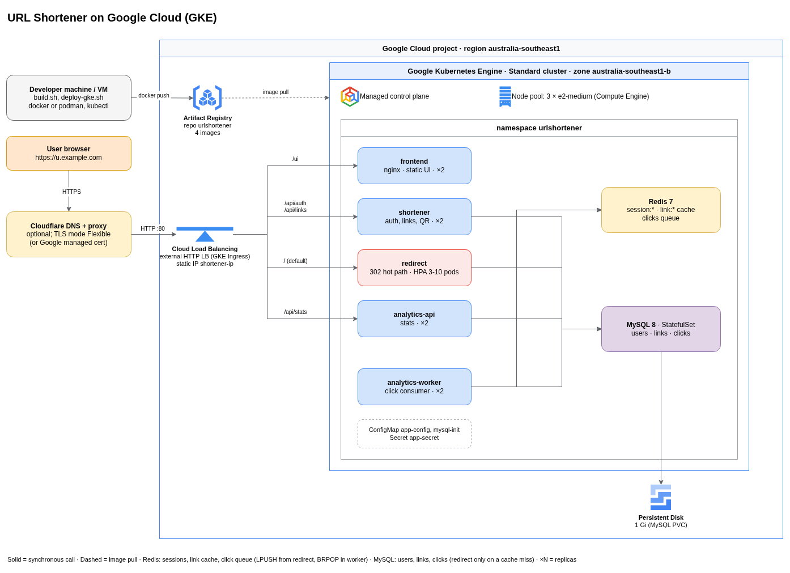

# URL Shortener - INFS3208 Project

> Author: Nihal Singh Atwal
  Student ID 49299175, 
  Email: nihalsingh.atwal@student.uq.edu.au

Github: https://github.com/nilz-bilz/INFS3208-url-shortener

A small URL shortener built as microservices and deployed on Kubernetes:
 Locally on [kind](https://kind.sigs.k8s.io/) and in the cloud on [GKE](https://cloud.google.com/kubernetes-engine). 
 
 The application itself is relatively minimal, with the aim of deploying cloud-native applications using k8s, and demonstrating scaling, health checks, load balancing, rolling updates and rollbacks.


Stack:
- Python 3.12 (Flask, gunicorn, PyMySQL, redis-py)
-  nginx
- MySQL 8.0 (StatefulSet)
- Redis 7, 
- plain HTML and vanilla JS for the UI. 
Four container images make five application Deployments, plus MySQL and Redis.

## Features

- Register, log in and log out (opaque session tokens kept in Redis).
- Create a short link for a long http(s) URL, with an optional expiry (1 hour to 1 year).
- Follow a short link: HTTP 302 to the target, with no caching so every visit is counted.
- List your links, edit the target URL or expiry, and delete links.
- QR code for each link: view it in the UI or download it as SVG. Scans are counted separately from normal visits.
- Per-link statistics: total clicks, web versus QR clicks, last click time and a 7-day chart.
- Top links by clicks.
- Every API response carries `X-Served-By` (pod name) and `X-App-Version`, so load balancing and rollouts are visible with `curl -I` and in the UI footer.

## System design



Components, each in its own container:

- **frontend** (nginx): serves the static UI under `/ui/`.
- **shortener** (Flask): authentication, link create/list/edit/delete and QR codes. Owns the `users` table and writes `links`.
- **redirect** (Flask): the hot read-only path. Looks the code up in Redis (MySQL on a miss), queues a click event, answers 302. This is the service the autoscaler scales (3 to 10 replicas at 50% CPU).
- **analytics-api** (Flask): statistics and top links. Same image as the worker.
- **analytics-worker** (Python loop): takes click events off a Redis list and writes them to MySQL.
- **MySQL** (StatefulSet, 1 Gi volume): `users`, `links`, `clicks`.
- **Redis** (Deployment, no persistence): link cache, sessions and the click queue.
- **Ingress**: one entry point that routes by path: `/ui` to frontend, `/api/auth` and `/api/links` to shortener, `/api/stats` to analytics-api, everything else to redirect. Under Docker Compose an nginx `gateway` container plays the same role.

Request flows:

1. Create a link: browser `POST /api/links` through the Ingress to shortener, which inserts into MySQL, caches `link:<code>` in Redis and returns 201.
2. Follow a link: browser `GET /<code>` goes to redirect, which reads Redis (MySQL on a miss), pushes a click event onto the Redis list and returns 302. If Redis is down it falls back to MySQL and skips the click; if MySQL is down, cached links still redirect.
3. Count a click: an analytics-worker pops the event, inserts a `clicks` row and increments `links.click_count`. Each event goes to exactly one worker, so several workers can run safely. A click can be lost if a worker dies mid-event.
4. View stats: browser `GET /api/stats/<code>` goes to analytics-api, which validates the session token in Redis and aggregates the last 7 days from MySQL.

**Kubernetes features in use:** Deployments with rolling updates (`maxUnavailable: 0`), pods spread across nodes, readiness and liveness probes (`/readyz`, `/healthz`), a preStop delay so the load balancer can drain, a HorizontalPodAutoscaler on redirect, a StatefulSet with a PersistentVolumeClaim for MySQL, ConfigMaps and a Secret for configuration, ClusterIP Services and an Ingress. The architecture diagram is `docs/architecture.drawio`; the full design is in `docs/SPEC.md`.

## API reference

Requests and responses are JSON. Endpoints marked "auth" need `Authorization: Bearer <token>` from `/api/auth/login`; a missing or expired token returns `401 {"error": "unauthorized"}`. All errors have the form `{"error": "<message>"}`.

### Auth and links (shortener)

| Method | Path | Auth | Body | Success | Errors |
| --- | --- | --- | --- | --- | --- |
| POST | `/api/auth/register` | no | `{"username", "password"}` (username 3-50 of `A-Za-z0-9_`, password 8+ chars) | `201 {"id", "username"}` | 400, 409 username taken |
| POST | `/api/auth/login` | no | `{"username", "password"}` | `200 {"token", "username"}` | 400, 401 |
| POST | `/api/auth/logout` | auth | none | `204` | 401 |
| GET | `/api/auth/me` | auth | none | `200 {"id", "username"}` | 401 |
| POST | `/api/links` | auth | `{"url", "expires_in_hours"?}` | `201` link object | 400 invalid url or expiry |
| GET | `/api/links` | auth | none | `200 [link, ...]` newest first | 401 |
| PATCH | `/api/links/<code>` | auth | `{"url"?, "expires_in_hours"?}`; `null` hours clears the expiry, omitting it keeps it | `200` link object | 400, 404 |
| DELETE | `/api/links/<code>` | auth | none | `204` | 404 not found or not yours |
| GET | `/api/links/<code>/qr` | no | none | `200` SVG of the short URL with `?src=qr` | 404 |

Link object: `{"code": "aZ3k9Q", "url": "https://...", "short_url": "<BASE_URL>/aZ3k9Q", "click_count": 0, "created_at": "2026-10-24T08:26:36Z", "expires_at": null}`. `expires_in_hours` is an integer from 1 to 8760. Codes are 6 random alphanumeric characters.

### Redirect

| Method | Path | Success | Errors |
| --- | --- | --- | --- |
| GET | `/` | `302` to `/ui/` | none |
| GET | `/<code>` | `302` to the target, `Cache-Control: no-store`. Add `?src=qr` to count the visit as a QR scan. | `404` plain text "Short link not found" for unknown or expired codes |

### Statistics (analytics-api, auth)

| Method | Path | Success | Errors |
| --- | --- | --- | --- |
| GET | `/api/stats/<code>` | `200` stats object | 401, 404 not found or not yours |
| GET | `/api/stats/top?limit=10` | `200 [{"code", "url", "click_count"}, ...]`, highest first (limit 1-50) | 401 |

Stats object: `{"code", "url", "total_clicks", "qr_clicks", "last_click_at", "daily": [{"date", "clicks", "qr_clicks"}, ...]}`. `daily` always has 7 entries (today and the 6 previous days, UTC, oldest first, zero-filled). `total_clicks` includes QR scans.

### Health (every backend)

`GET /healthz` returns `200 {"status": "ok"}` without touching dependencies (liveness). `GET /readyz` checks MySQL and Redis and returns `200 {"status": "ready"}` or `503 {"status": "not ready"}` (readiness). The frontend serves both paths too.

## Deployment

All commands run from the repository root. Three environments, in order of effort: Docker Compose, a local kind cluster, and GKE.

Configuration comes from environment variables. Copy the dev defaults first; `.env` is git-ignored and is also the source of the Kubernetes Secret.

```bash
# Create your local env file from the dev defaults (-n: never overwrite an existing .env)
cp -n .env.example .env
```

### 1. Docker Compose (no Kubernetes)

Prerequisites: docker and docker compose (same commands with podman)

```bash
# Build the images and start all containers in the background (-d detach, --build rebuild images)
docker compose up -d --build

# Show container state; everything should be Up
docker compose ps
```

The app is at http://localhost:8080/ui/ (only the gateway container publishes a port). Load the demo data with the seed command in section 6.

```bash
# Stop and remove the containers; add -v to also delete the MySQL volume
docker compose down
```

### 2. kind (local Kubernetes)

Prerequisites: kind, kubectl, and podman or docker. The scripts pick podman if it is installed and set `KIND_EXPERIMENTAL_PROVIDER=podman` for you. 
Port 8080 on the host must be free (stop the Compose stack first). kind needs raised inotify limits or its nodes fail with "too many open files":

```bash
# Raise the per-user inotify limits (needs sudo; add the two settings to /etc/sysctl.d/99-kind.conf to keep them across reboots)
sudo sysctl fs.inotify.max_user_instances=1024 fs.inotify.max_user_watches=524288
```

Build the images and deploy:

```bash
# Build the four images as localhost/<name>:v1 (the tag is baked in as APP_VERSION)
./scripts/build.sh v1

# Create the kind cluster (1 control-plane + 2 workers), install ingress-nginx and metrics-server,
# load the images, create the Secret and MySQL init ConfigMap, apply k8s/overlays/local, wait for rollouts
./scripts/deploy-local.sh v1
```

Check it:

```bash
# All pods should be Running and Ready
kubectl get pods -n urlshortener

# TARGETS should show a CPU % after about a minute (not <unknown>)
kubectl get hpa -n urlshortener

# The UI answers through the Ingress (HTTP 200)
curl -s -o /dev/null -w "%{http_code}\n" http://localhost:8080/ui/
```

Open http://localhost:8080/ui/. The script is safe to re-run. To delete the cluster:

```bash
# Delete the kind cluster and everything in it
kind delete cluster --name shortener
```

For the rollout demo you also need a v2 image inside the cluster. The only difference is the version header and UI footer:

```bash
# Build the v2 images
./scripts/build.sh v2

# Load redirect and frontend v2 into the kind nodes (use docker instead of podman if that is your engine)
for n in redirect frontend; do
  docker save localhost/$n:v2 -o /tmp/$n-v2.tar
  kind load image-archive /tmp/$n-v2.tar --name shortener
done
```

Do not run `deploy-local.sh v2`: it re-applies the overlay, which pins the images back to `:v1`.

### 3. GKE (Google Cloud)

Prerequisites: a Google Cloud project with billing, the `gcloud` CLI (logged in), kubectl, `gke-gcloud-auth-plugin`, and podman or docker. The steps below create billable resources; see the cost notes at the end.

```bash
# Select the project, region and zone (the scripts read these from the gcloud config)
gcloud config set project <PROJECT_ID>
gcloud config set compute/region australia-southeast1
gcloud config set compute/zone australia-southeast1-b

# Install the authentication plugin kubectl needs for GKE (Debian/Ubuntu apt install of the Google Cloud CLI)
sudo apt-get install google-cloud-cli-gke-gcloud-auth-plugin
```

One-off cloud setup:

```bash
# Enable the Kubernetes Engine and Artifact Registry APIs
gcloud services enable container.googleapis.com artifactregistry.googleapis.com

# Create a Docker image repository named urlshortener
gcloud artifacts repositories create urlshortener --repository-format=docker --location=australia-southeast1

# Create a zonal cluster with 3 e2-medium nodes (BILLABLE). e2-small nodes ran out of CPU when the HPA scaled to 10 pods
gcloud container clusters create shortener --num-nodes 3 --machine-type e2-medium

# Write a kubeconfig entry so kubectl talks to the new cluster
gcloud container clusters get-credentials shortener

# Reserve the global static IP used by the Ingress, then print it
gcloud compute addresses create shortener-ip --global
gcloud compute addresses describe shortener-ip --global --format='value(address)'
```

Choose how the app is exposed. The deploy script reads one of two variables, or neither:

- **HTTP on the static IP** (simplest): no variable. Short links use `http://<static-ip>`.
- **Google-managed HTTPS certificate**: create an `A` record for your domain pointing at the static IP, **not proxied** (for Cloudflare: DNS only, grey cloud). Deploy with `DOMAIN=s.example.com`. The certificate can take up to an hour to become Active.
- **HTTPS terminated by Cloudflare**: create a **proxied** `A` record to the static IP, set the zone's SSL/TLS mode to **Flexible** (the origin has no certificate; Full gives error 525). Deploy with `PUBLIC_URL=https://s.example.com`. No Google certificate is created.

Set strong values for `DB_PASSWORD` and `MYSQL_ROOT_PASSWORD` in `.env`; the script turns them into the Kubernetes Secret. Then build and deploy:

```bash
# Build the images locally as localhost/<name>:v1
./scripts/build.sh v1

# Push the images to Artifact Registry, create the Secret and ConfigMap, apply k8s/overlays/gke and wait for rollouts.
# Pick ONE of: DOMAIN=<host> (managed certificate), PUBLIC_URL=<https url> (HTTPS elsewhere), or neither (HTTP on the IP)
PUBLIC_URL=https://s.example.com ./scripts/deploy-gke.sh v1
```

Add `DRY_RUN=1` to print the commands without running them. The Google load balancer takes about 3 to 5 minutes to start serving; until then you get 404 or 502.

```bash
# Pods, HPA and Ingress (the Ingress ADDRESS should be the static IP)
kubectl get pods,hpa,ingress -n urlshortener

# Managed certificate only: wait for Status: Active
kubectl describe managedcertificate shortener-cert -n urlshortener
```

Push the v2 images for the rollout demo (not deployed):

```bash
# Build v2, then tag and push redirect and frontend to the registry
./scripts/build.sh v2
for n in redirect frontend; do
  podman tag localhost/$n:v2 australia-southeast1-docker.pkg.dev/<PROJECT_ID>/urlshortener/$n:v2
  podman push australia-southeast1-docker.pkg.dev/<PROJECT_ID>/urlshortener/$n:v2
done
```

To change the host used in short links (`BASE_URL`), re-run `deploy-gke.sh` with the new `PUBLIC_URL` or `DOMAIN`. The shortener reads the value only at startup, so restart it afterwards:

```bash
# Restart the shortener pods to pick up the changed BASE_URL
kubectl rollout restart deploy/shortener -n urlshortener
```

Cost control and teardown:

```bash
# Stop paying for nodes while idle (the MySQL disk and data stay); resize back to 3 to resume (about 10 minutes until ready)
gcloud container clusters resize shortener --node-pool <NODE_POOL> --num-nodes 0
gcloud container clusters resize shortener --node-pool <NODE_POOL> --num-nodes 3

# Final teardown: delete the cluster, release the static IP, remove the image repository
gcloud container clusters delete shortener
gcloud compute addresses delete shortener-ip --global
gcloud artifacts repositories delete urlshortener --location=australia-southeast1
```

Find the node pool name with `gcloud container node-pools list --cluster shortener`. Running 3 `e2-medium` nodes costs a few dollars a day; with nodes at 0 the remaining load balancer, disk and registry cost well under a dollar a day. Check the Billing console for exact figures.

## Seed, demo and troubleshooting

### Seed data

`scripts/seed.py` creates the user `demo` / `demo1234`, 50 links and about 20,000 clicks spread over 30 days (about 15% QR scans, more on a few links). Links 30 to 34 expire in 2 hours, 35 to 39 in a week and 45 to 49 are already expired, so the expiry states are visible. It reads the `DB_*` variables and replaces the demo user if it exists, so it is safe to re-run. Run it where the database is reachable:

```bash
# Compose: run the script inside the shortener container (-T: no TTY so stdin can feed the file)
docker compose exec -T shortener python - < scripts/seed.py

# kind or GKE: run it inside a shortener pod (-i passes the file on stdin; the pod already has the DB_* variables)
kubectl exec -i deploy/shortener -n urlshortener -- python - < scripts/seed.py
```

### Demo

`scripts/demo.sh` walks through load balancing, manual scaling, autoscaling, reliability, a rolling update to v2 and a rollback. It prints each command with a one-line description before running it and pauses between steps. Prerequisites are listed in the script header: kubectl pointing at the right cluster, the app deployed and seeded, a v2 redirect image available to the cluster, and no recent load test (wait about 5 minutes so the HPA is back at 3 replicas).

```bash
# kind
./scripts/demo.sh

# GKE: use the static IP for the load steps (the Cloudflare proxy can throttle load tests) and the registry v2 image
HOST=http://<STATIC_IP> REDIRECT_V2=australia-southeast1-docker.pkg.dev/<PROJECT_ID>/urlshortener/redirect:v2 ./scripts/demo.sh

# Run without pausing between steps
NOPAUSE=1 ./scripts/demo.sh
```

### Troubleshooting

- **502 from the Compose gateway after recreating containers:** nginx cached the old container addresses. Run `docker compose restart gateway`.
- **A Compose database created before expiry and QR support lacks columns:** run `docker compose down -v` and start again (this deletes the data), or add `links.expires_at DATETIME NULL` and `clicks.source VARCHAR(8) NOT NULL DEFAULT 'web'` with `ALTER TABLE`.
- **kind nodes fail with "too many open files":** raise the inotify limits (see the kind section).
- **HPA shows `<unknown>`:** metrics take about a minute to appear after pods start. If it persists, check `kubectl get pods -n kube-system | grep metrics-server`.
- **Redirect pods stuck Pending on GKE:** the nodes are out of CPU. Use `e2-medium` or larger nodes, or lower the HPA maximum.
- **`gke-gcloud-auth-plugin` not found:** install it (see the GKE prerequisites).
- **GKE returns 404 or 502 for the first few minutes:** the load balancer is still being programmed. Check `kubectl get ingress -n urlshortener` and retry.
- **Cloudflare error 525:** the zone's SSL/TLS mode is Full. Set it to Flexible.
- **Short links show the IP or an old host:** `BASE_URL` was not updated; redeploy with the right `PUBLIC_URL` or `DOMAIN` and restart the shortener.
- **UI looks stale after a deploy:** hard-refresh (Ctrl+Shift+R).
- **Wrong cluster:** the scripts and demo use the current kubectl context. Check it with `kubectl config current-context` and switch with `kubectl config use-context <name>`.

## Decisions

- MySQL runs with `--authentication-policy=mysql_native_password` so PyMySQL can log in without the `cryptography` package. This is set in both `docker-compose.yml` and `k8s/base/mysql.yaml`.
- `/healthz`, `/readyz` and the JSON error handlers live in each service's `common.py` (`register_common`), which is duplicated per service by design.
- On GKE the cluster has 3 `e2-medium` nodes; smaller nodes ran out of CPU during autoscaling. HTTPS can come from a Google-managed certificate or from a Cloudflare proxy (Flexible mode).
- The scripts use podman when it is installed and docker otherwise (my local dev machine had podman)
